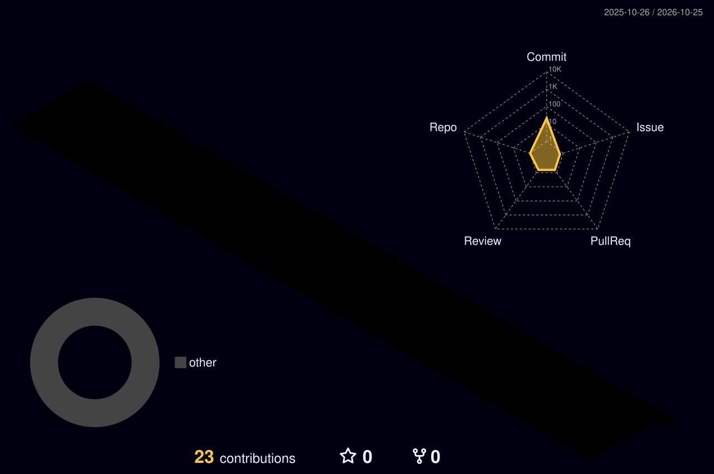

 

  

  

  

  

## Projects I'm Building Toward

| Project | Description | Stack |
|---|---|---|
| **Task Manager** | To-do app to practice core programming and app structure. | Python or JavaScript |
| **Weather App** | Live weather lookup using a public API. | HTML, CSS, JavaScript |
| **Student Management System** | Records system with database queries and joins. | Java, MySQL |

More ideas on the list: a personal portfolio website and a basic ML prediction model (Python, scikit-learn).

  

  

